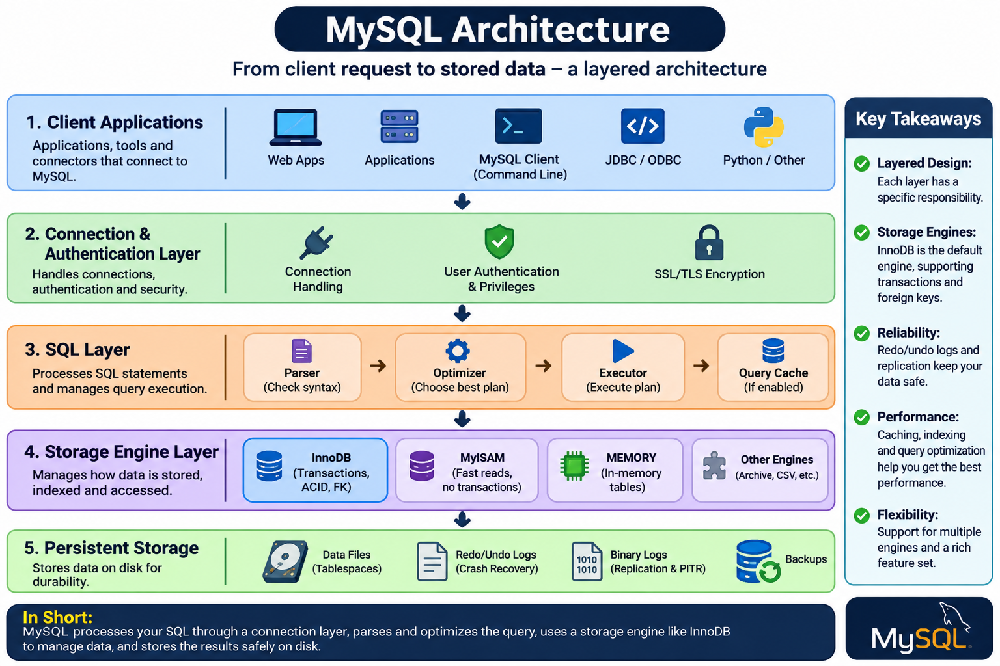
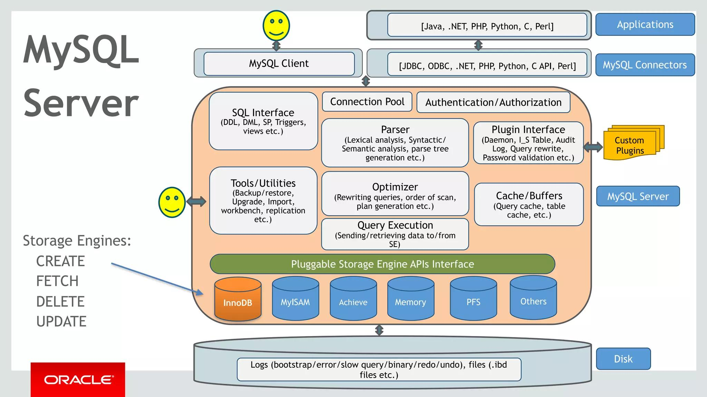
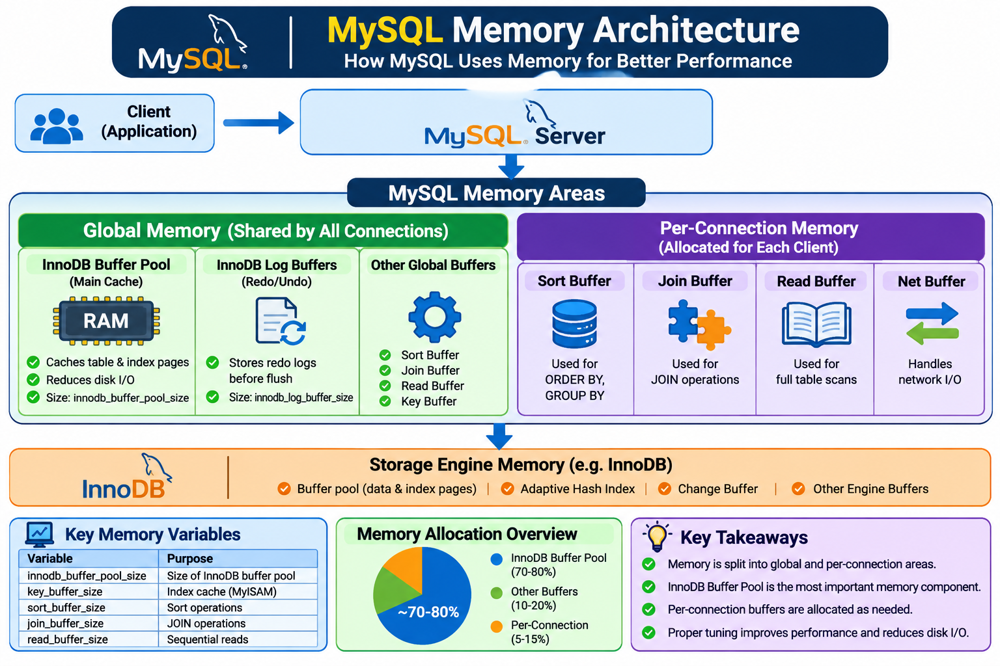
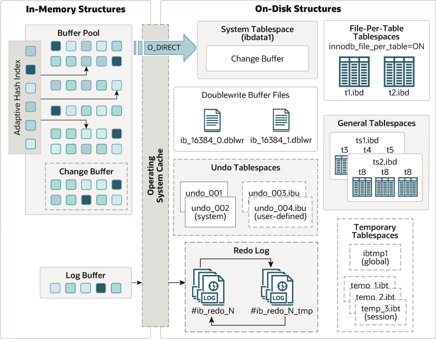

## MySQL Interview Questions:

MySQL, the most popular Open Source SQL database management system, is developed, distributed, and supported by Oracle Corporation.


_Main features of MySQL:_
- Written in C and C++.
- Relational database management using SQL.
- ACID-compliant transactions with InnoDB.
- Indexing and query optimization.
- Replication and Group Replication.
- Backup and recovery.
- User authentication and privilege management.
- Partitioning and stored procedures.


### What is MySQL?

MySQL is an open-source relational database management system (RDBMS) that uses SQL to store, manage, and retrieve structured data. It supports transactional workloads, multiple storage engines, replication, and high availability.


### Explain the MySQL Architecture:

MYSQL is a relational database that has a layered kind of architecture. It’s a database system has a three-layered architecture. An architecture consists of three layers: a server resource end, a storage engine, and a client-end or query execution end.


_MySQL Architecture with Pluggable Storage Engines:_ [MySQL Architecture](https://dev.mysql.com/doc/refman/8.4/en/pluggable-storage-overview.html)

Diagram-1:



Diagram-2:



#### 1. Client Layer:
MySQL does not have a unique top layer, i.e., client. This is the top-most layer where external applications, database tools, or CLI environments interact with MySQL. The Client give request instructions to the Serve with the help of Client Layer. Network tools provide authentication, security, and connection handling in client-server models.

- **Connection Handling** : To establish a connection with the server, the client must send a request, and the server must accept it. There is a **thread for every client connection** within the server process. Every time a client connects to the server at that time, it gets its own thread. This thread executes all client-side queries.  
Every time a new connection is initiated, the **server caches the threads**, so it doesn’t have to create and destroy them every time. The API in MySQL 5.5 and higher supports thread-pooling plugins so that a small pool of threads can handle many connections.

- **Authentication/authorization**: When a client connects to the MySQL server, authentication is performed on the server side. An authentication process takes place through the use of a username and password.   

- **Security**: Once the user has authenticated successfully, the server checks if the user is authorized to run certain queries on the database.


#### 2. Server Layer (mysqld):
The second layer of MySQL architecture is responsible for all logical functionalities of relational database management system of MySQL. This Layer of MySQL System is also known as "Brain of MySQL Architecture".   
It includes many operations, such as **query parsing, optimization, analysis, caching,** and all the built-in functions (e.g., dates, times, math, and encryption). At this level, any functionality, such as **stored procedures, triggers, and views**, can be used across storage engines.

- **Thread Handling (Managing Client Sessions)**: When a client send request to the server and server will accept the request and the client is connected. When Client is connected to the server at that time, a client get it's own thread for it's connection. This thread is provided by  thread handling  of Server Layer. Also the queries of  client side  which is executed by the thread  is also handled by Thread Handling module.   
The connection handler manages individual client sessions, handling authentication, authorization, and session state management. Each connection maintains its own thread (in traditional threaded model) or is handled by a thread pool worker.

- **Parser** : The parser is MySQL's first line of defense against malformed SQL. It performs lexical analysis, syntax checking, and builds an Abstract Syntax Tree (AST) that represents the logical structure of your query. **Validates the SQL syntax of the incoming query and translates it into an internal data structure (a parse tree).**  
A Parser is a type of Software Component that  built a data structure (parse tree)  of  given input . Before parsing lexical  analysis is done i.e. input is broken into number of tokens . After the  data is available in the smaller elements parser perform Syntax Analysis , Semantics  Analysis after that parse tree is generated as output.

- **Optimizer** : As soon as the parsing is done, various types of optimization techniques are applied at Optimizer Block. These techniques may include rewriting the query, order of scanning of tables and choosing the right indexes to use etc.  
It takes the parsed query and generates the most efficient execution plan possible, considering available indexes, table statistics, join ordering, and various access methods. It considers:
    - Available indexes.
    - Table statistics.
    - Join order.
    - Access methods.
    - Estimated query costs.
    - Cost Estimation: I/O cost, CPU cost, memory usage

- **Query Cache (Removed in MySQL 8.0)** : In the Query Cache, the results of each query statement are stored. Before parsing, MySQL Server consults the query cache. When client write a query , if the query written by client is identical in the cache then the server simply skip the parsing, optimization and even execution, it just simply display the output from the cache.

> MySQL 8.0+: Completely removed. Use application-level cache (Redis, Memcached) or InnoDB buffer pool.

- **Buffer and Cache** : This component manages memory used by the server and storage engines. Cache and will buffer store the previous query or problem asked by user. When User write a query then it firstly goes to Query Cache then query cache will check that the same query or problem is available in the cache. If the same query is available then it will provide output without interfering Parser, Optimizer.

- **Table Metadata Cache** : The metadata cache is a reserved area of memory used for tracking information on databases, indexes, or objects. The greater the number of open databases, indexes, or objects, the larger the metadata cache size.

- **Key Cache** : A  key cache  is an index entry that uniquely identifies an object in a cache. By default, edge servers cache content based on the entire resource path and a query string.


#### 3. Storage Layer:

An integral part of MySQL’s architecture is its Storage Engine layer. The storage engine manages how database tables are physically stored and accessed. There are a few storage engines commonly used, including **MyISAM** and **InnoDB**. Storage engines communicate with **MySQL servers using API**.


#### 4. Physical File System Layer:

This is the persistent storage layer where MySQL stores database data and logs. MySQL stores data in files (OS-level). 

- **Data Files** (`.ibd`)	: Store the physical table data and indexes. InnoDB **file-per-table** tablespace. 
- **System Tablespace** (`ibdata1`)	: InnoDB system tablespace (in configurations using it)
- **Redo logs** (`ib_logfile0`, `ib_logfile1`)	: Crash recovery. Used by InnoDB for crash durability, recording changes before they are committed to data files.
- **Undo tablespaces** (`undo_001`, `undo_002`)	: Keep records of old versions of data to facilitate transaction rollbacks and Multi-Version Concurrency Control (MVCC).
- **Binary logs**	(`binlog.000001`):  Track all modified transactions globally, serving as the foundation for database replication and point-in-time recovery.
- **General query log**	: Records client connections and SQL statements
- **Error log**	: Server errors and startup information
- **Slow query log**	(`slow.log`) : Records queries exceeding configured thresholds
- **DDL logs**	: Internal DDL recovery information


### What are the different storage engines available in MySQL?
_The common storage engines are:_
- **InnoDB** (default in MySQL for transactional data)
- **MyISAM** (older, non-transactional storage engine)
- **MEMORY** (stores data in memory. Extremely fast but lost on restart.)
- **CSV** (stores data in CSV files. No indexing.)
- **ARCHIVE** (used for storing large amounts of data, read-only)


### What are the main differences between the InnoDB and MyISAM storage engines?

#### InnoDB: 
InnoDB is the default storage engine in MySQL. It supports ACID transactions, **row-level locking**, foreign keys and crash recovery.

- Supports transactions (ACID compliant).
- Allows **row-level locking**, making it better for multi-user environments (MVCC).
- Supports foreign keys and relationships between tables.
- Ideal for applications that require data consistency and reliability.
- Redo and undo logging.
- Crash recovery.


_InnoDB Tablespace Architecture (simplified):_
```
System tablespace (ibdata1)
├── Doublewrite buffer
├── Change buffer
├── Undo logs (unless separate undo tablespace)
└── Data dictionary (in 8.0, moved to mysql.ibd)

File-per-table (table.ibd)
├── B-Tree data pages
├── Index pages
└── Insert buffer bitmap
```


```
SHOW ENGINES;

+--------------------+---------+----------------------------------------------------------------+--------------+------+------------+
| Engine             | Support | Comment                                                        | Transactions | XA   | Savepoints |
+--------------------+---------+----------------------------------------------------------------+--------------+------+------------+
| ndbcluster         | NO      | Clustered, fault-tolerant tables                               | NULL         | NULL | NULL       |
| FEDERATED          | NO      | Federated MySQL storage engine                                 | NULL         | NULL | NULL       |
| MEMORY             | YES     | Hash based, stored in memory, useful for temporary tables      | NO           | NO   | NO         |
| InnoDB             | DEFAULT | Supports transactions, row-level locking, and foreign keys     | YES          | YES  | YES        |
| PERFORMANCE_SCHEMA | YES     | Performance Schema                                             | NO           | NO   | NO         |
| MyISAM             | YES     | MyISAM storage engine                                          | NO           | NO   | NO         |
| ndbinfo            | NO      | MySQL Cluster system information storage engine                | NULL         | NULL | NULL       |
| MRG_MYISAM         | YES     | Collection of identical MyISAM tables                          | NO           | NO   | NO         |
| BLACKHOLE          | YES     | /dev/null storage engine (anything you write to it disappears) | NO           | NO   | NO         |
| CSV                | YES     | CSV storage engine                                             | NO           | NO   | NO         |
| ARCHIVE            | YES     | Archive storage engine                                         | NO           | NO   | NO         |
+--------------------+---------+----------------------------------------------------------------+--------------+------+------------+
```


#### MyISAM: 
MyISAM is known for its simplicity and speed, making it a good choice for read-heavy operations. However, it doesn't support transactions or foreign keys, which limits its use in more complex applications.

A legacy, non-transactional engine. It uses **table-level locking** and lacks foreign key support, making it faster strictly for read-heavy operations with low write frequency.

- Does not support transactions.
- Faster for read-heavy operations.
- Does not support foreign keys.
- Better suited for applications that focus more on reading data than writing. 


_Key Architectural Comparison: InnoDB vs. MyISAM:_

| Architectural Component	| InnoDB Engine (Modern Default)	| MyISAM Engine (Legacy Standard) |
| ----------------------	| ------------------------------	| ------------------------------- |
| Transaction Support	| Full ACID compliance	| No |
| Locking Mechanism	| Row-level locking (high concurrency)	| Table-level locking (blocks active writes) |
| Crash Recovery	| Automatic via Redo/Undo logs |	Prone to corruption upon abrupt crashes |
| Foreign Keys	| Supported	| Not supported |


### Why is InnoDB the default storage engine?

Because it supports:
- ACID transactions.
- Row-level locking.
- MVCC.
- Foreign keys.
- Crash recovery.
- Redo and undo logging.
- Clustered indexes.


### Explain the MySQL Memory Architecture:


Key concepts to remember:
1. **Global Memory (Per-Instance Allocations)**: Shared memory used by all connections, including the InnoDB Buffer Pool.
2. **Per-Connection Memory (Session Memory)**: Buffers allocated to individual client connections as needed.
3. **InnoDB Memory**: Includes the InnoDB Buffer Pool, Adaptive Hash Index, Change Buffer, Log Buffer, and other engine-related memory.
4. **Memory Tuning**: Requires balancing shared memory, connection count, and workload-specific buffer requirements.


Diagram-1:
 


Diagram-2:
 


#### Buffer Pool:

The Buffer Pool is the main memory area of InnoDB. It caches frequently accessed table data and index pages.

Primarily used to cache data pages, index pages, undo pages, adaptive hash indexes, and lock information. When retrieving data, if the data is present in the Buffer Pool, it can be directly accessed, avoiding disk I/O and enhancing performance. For writing data, modifications are first made to the data pages in the Buffer Pool, followed by employing a certain strategy to flush and update the disk data.


_Buffer Pool Contents:_
- Data Pages: Table data cached in 16KB pages
- Index Pages: B-tree index structures
- Insert Buffer: Delayed secondary index maintenance
- Adaptive Hash Index: Automatic in-memory hash indexes
- Lock Information: Row locks and table locks
- Data Dictionary: Table metadata and schema information
- Reduce disk I/O.
- Hold modified (dirty) pages before they are written to disk.
- Improve read and write performance.


#### Change Buffer:
The Change Buffer temporarily stores changes to secondary index pages that are not currently in the Buffer Pool.

A change buffer is a common B+ tree. When a secondary index page is not in Buffer Pool, the changes generated by DML operations, such as **insertions, updates, and deletions**, are cached in the change buffer. The caches are merged at appropriate times to reduce disk I/O operations. The memory source of a change buffer is the buffer pool.

You can set the maximum size by using the innodb_change_buffer_max_size parameter. The default value is 25%, and the maximum value is 50%.

_Benefits:_
- Reduces random disk I/O.
- Improves certain INSERT, UPDATE, and DELETE workloads.
- Delays some secondary-index page modifications.


#### Adaptive Hash Index (AHI):

The Adaptive Hash Index is an optional InnoDB feature that **automatically builds hash indexes for frequently accessed index pages**.


_Purpose:_
- Accelerates certain index lookups.
- Reduces B-tree search overhead.
- Improves performance for suitable access patterns.


Check configuration:
```sql
SHOW VARIABLES LIKE 'innodb_adaptive_hash_index';
```


#### Log Buffer:
The Log Buffer is a memory area that **temporarily holds redo log records** before they are written to redo log files.


_Purpose:_
- Temporarily stores redo records.
- Reduces frequent small writes to redo log files.
- Supports transaction durability mechanisms.


Check configuration:
```sql
SHOW VARIABLES LIKE 'innodb_log_buffer_size';
```


#### Key Cache:
MyISAM's key cache is a memory area similar in role to InnoDB's buffer pool, used to cache the indexes of MyISAM tables. (In the MyISAM storage engine, index blocks are cached in a special area called the key cache, but there is no special cache for data blocks; instead, the file system cache provided by the operating system is used.)

The key cache can be accessed by multiple sessions at the same time, and you can configure several key caches or assign indexes to a specific cache.


#### Query Cache: 
The query cache was introduced in MySQL 4.0.1, deprecated as of MySQL 5.7.20, and completely removed in MySQL 8.0.


#### Table Cache:
To read and write a table in MySQL, you always have to open it and close it after use. Because this creates overhead, information about opened tables is kept in a dedicated space. This space is called the table cache, and threads share it.


However, threads cannot share the same information (table), so the more threads access the same table, the more additional memory is needed to store that information.

Because MySQL runs with multiple threads, there can be many clients running queries against the same table at the same time, but the same table is not shared between threads. The more threads access the same table, the more tables have to be opened, which uses additional memory.


#### Operating System Cache:

Normally, filesystem caching can involve both the InnoDB Buffer Pool and the OS page cache.

With O_DIRECT, InnoDB can bypass the OS page cache for relevant data-file I/O, avoiding duplicate caching.


Check configuration:
```sql
SHOW VARIABLES LIKE 'innodb_flush_method';

+---------------------+----------+
| Variable_name       | Value    |
+---------------------+----------+
| innodb_flush_method | O_DIRECT |
+---------------------+----------+
```


### What is the InnoDB buffer pool?

The buffer pool is a memory area used to cache table and index pages. Frequently accessed pages can be served from memory rather than disk.


```sql
SHOW VARIABLES LIKE 'innodb_buffer_pool_size';
SHOW GLOBAL STATUS LIKE 'Innodb_buffer_pool_read%';

SHOW ENGINE INNODB STATUS\G
```


### What is the InnoDB redo log?

The redo log records changes needed to recover modified database pages after a crash. It helps provide durability and crash recovery.


### What is the most important memory component in InnoDB?

The InnoDB **Buffer Pool** because it caches table and index pages and reduces physical disk I/O.


### What is the difference between Buffer Pool and Log Buffer?
- **Buffer Pool** caches database data and index pages.
- **Log Buffer** temporarily stores redo log records before flushing them to redo log files.


### What is the undo log?

The undo log stores information needed to reverse changes and provide older row versions for MVCC. It supports transaction rollback and consistent reads.


### What are binary logs, and why are they important? 

Binary logs (binlogs) record all changes to MySQL databases, such as inserts, updates, and deletes. 

- Essential for replication.
- Used for point-in-time recovery during backups.
- Useful for auditing data changes. 


### What is the difference between `.ibd` and `ibdata1`?
- `.ibd` generally represents an individual InnoDB file-per-table or general tablespace file.
- `ibdata1` is commonly an InnoDB system tablespace file.


### What is MVCC?

Multi-Version Concurrency Control allows InnoDB to maintain multiple versions of rows so that consistent reads can access an appropriate snapshot without blocking every concurrent write.


### What is a dirty page?

A dirty page is a modified page in the Buffer Pool that has not yet been written to its corresponding tablespace on disk.


### What is SQL? 

SQL (Structured Query Language) is the standard language used to manage and manipulate databases. SQL is the language, and MySQL is the software that understands it. 


### What is Performance Schema?
Performance Schema is a built-in MySQL monitoring facility that collects runtime performance data from the MySQL server. The Performance Schema is enabled by default.

It provides detailed information about:
- SQL statement execution.
- Query execution time.
- Table and index I/O.
- Wait events.
- Mutex and synchronization waits.
- Memory consumption.
- Connection activity.
- Lock contention.
- File I/O activity.


```sql
SHOW VARIABLES LIKE 'performance_schema';
USE performance_schema;
SHOW TABLES;


SELECT TABLE_NAME FROM INFORMATION_SCHEMA.TABLES
       WHERE TABLE_SCHEMA = 'performance_schema';


SELECT * FROM INFORMATION_SCHEMA.ENGINES 
       WHERE ENGINE='PERFORMANCE_SCHEMA'\G
```


### What is sys Schema?
The sys schema is a collection of views, stored procedures, and functions designed to make MySQL performance information easier to understand.

It uses information from Performance Schema and other sources to provide DBA-friendly reports.


```sql 
SHOW DATABASES LIKE 'sys';
USE sys;
SHOW FULL TABLES;
```


_The main difference:_
- **Performance Schema**: Collects low-level performance information from the MySQL server.
- **sys Schema**: Provides user-friendly views and stored procedures built on top of Performance Schema and other system information.


### What is INFORMATION Schema?

`INFORMATION_SCHEMA` provides access to database metadata, information about the MySQL server such as the name of a database or table, the data type of a column, or access privileges. Other terms that are sometimes used for this information are data dictionary and system catalog.


### What is the default authentication plugin in MySQL 8.0?

The default authentication plugin in MySQL 8.0 is `caching_sha2_password`. This was introduced to provide better security compared to the older `mysql_native_password` plugin by using a more robust SHA-256 hashing mechanism. It also includes support for password caching which can help minimize the need to re-authenticate connections, improving overall performance.


### What are the main MySQL data types?

- Integer:	`TINYINT`, `SMALLINT`, `INT`, `BIGINT`
- Exact numeric:	`DECIMAL`, `NUMERIC`
- Approximate numeric:	`FLOAT`, `DOUBLE`
- String:	`CHAR`, `VARCHAR`, `TEXT`
- Date and time:	`DATE`, `TIME`, `DATETIME`, `TIMESTAMP`, `YEAR`
- Binary:	`BINARY`, `VARBINARY`, `BLOB`
- JSON:	`JSON`
- Spatial:	`GEOMETRY`, `POINT`, `POLYGON`


### What are the differences between INNER JOIN, LEFT JOIN, RIGHT JOIN, and FULL JOIN?

_Joins combine rows from two or more tables based on related columns. Here are their differences:_
- **INNER JOIN**: Returns rows where there is a match in both tables.
- **LEFT JOIN**: Returns all rows from the left table and matching rows from the right table. If there’s no match, `NULL` is returned for the right table's columns.
- **RIGHT JOIN**: Similar to `LEFT JOIN`, it returns all rows from the right table and matching rows from the left.
- **FULL JOIN**: Combines the `LEFT JOIN` and `RIGHT JOIN` results, including unmatched rows from both tables. 

**Note**: MySQL does not natively support `FULL JOIN` syntax. To achieve the same result, use a `UNION` of a `LEFT JOIN` and a `RIGHT JOIN`


### What is the difference between DELETE, TRUNCATE, and DROP in MySQL?

1. `DELETE`: Removes rows from a table based on a condition. It can be rolled back if inside a transaction. Example: `DELETE FROM employees WHERE department_id = 5;`
2. `TRUNCATE`: Deletes all rows from a table, but the table structure remains intact. It is faster than DELETE and cannot be rolled back. Example: `TRUNCATE TABLE employees;`
3. `DROP`: Completely removes the table structure and data, along with any dependencies like indexes. Example: `DROP TABLE employees;`


### What are the differences between CHAR and VARCHAR data types in MySQL?

| CHAR	| VARCHAR |
| ----	| ------- |
| Stores fixed-length strings. |	Stores variable-length strings. |
| Pads extra spaces if the value is shorter than the defined length. |	Stores only the actual characters entered. |
| Can store up to 255 characters. |	Can store up to 65,535 bytes (subject to row size limits). |


### Explain the main difference between FLOAT and DOUBLE?

| FLOAT | DOUBLE |
| ----- | ------ |
| Uses 4 bytes of storage. |	Uses 8 bytes of storage. |
| Provides approximately 7 decimal digits of precision. |	Provides approximately 15 decimal digits of precision. | 
| Suitable for values that require less precision. |	Suitable for values that require higher precision. |


### Explain the differences between BLOB and TEXT?

| BLOB | TEXT |
| ---- | ---- |
| Stores binary data. |	Stores text data. | 
| Used for images, audio, videos and other binary files. |	Used for storing large amounts of text, such as articles, descriptions and comments. |
| Binary data is not associated with a character set. |	Text data is stored using a character set and collation. |


### Explain the difference between HAVING and WHERE clause in MySQL?

| WHERE	| HAVING | 
| ----	| ------ | 
| Filters rows before grouping. |	Filters groups after grouping. | 
| Used before the GROUP BY clause. |	Used after the GROUP BY clause. |
| Cannot use aggregate functions directly. |	Can use aggregate functions such as COUNT(), SUM() and AVG(). |


### What are a primary key and a foreign key? 

#### Primary key: 
A primary key is a column that uniquely identifies each record in a table. In MySQL, no two rows can have the same primary key value, and a record cannot exist without one, meaning it cannot be NULL.
- Uniquely identifies each record in a table.
- Does not allow NULL values.
- Each table can have only one primary key.
- Automatically creates a clustered index in MySQL (InnoDB).

#### Foreign key: 
A foreign key is a column in one table that references the primary key in another table.  

A foreign key is a field (or collection of fields) in one table that uniquely identifies a row of another table. It's basically a way to enforce referential integrity within your database by creating a link between tables.


#### Unique key: 
- Ensures all values in a column (or set of columns) are unique.
- Allows one NULL value because NULL is treated as “unknown.”
- A table can have multiple unique keys. 


```sql
CREATE TABLE Employees ( 
  EmpID INT PRIMARY KEY, 
  Email VARCHAR(100) UNIQUE 
); 
```


### What are constraints in MySQL? 
Constraints are rules applied to table columns to maintain data integrity. 


### What is an Index in MySQL?
An Index is a database object that improves the speed of data retrieval from a table. It helps MySQL search records faster.

An index is a data structure that helps MySQL find rows without scanning every row in a table. Indexes can improve read performance but consume storage and add overhead to inserts, updates, and deletes.

An index in MySQL is a data structure that improves the speed of data retrieval operations on a database table. Think of it like an index in a book that helps you quickly find the page containing the information you need. 


```sql
CREATE INDEX index_name ON table_name(column_name);
```


_Indexes have some drawbacks:_
- **Slower write operations**: `INSERT`, `UPDATE`, and DELETE operations are slower because the **index must be updated each time data changes**.
- **Storage cost**: Indexes require additional storage space.


### What are the different types of MySQL indexes?
- Primary key index
- Unique index
- Non-unique index
- Composite index
- Full-text index
- Spatial index
- Prefix index


### What is the maximum number of columns allowed in a MySQL index?

A MySQL index can contain a **maximum of 16 columns (for InnoDB)**. This is known as a composite index, where multiple columns are combined into a single index to improve query performance.


### What is a View? How to create a View in MySQL?
A View is a virtual table created from one or more tables using a SQL query. It does not store data itself but displays data from the underlying tables.


### What is a Trigger in MySQL?
A trigger is a set of codes that executes in response to some events.

A Trigger is a database object that automatically executes a set of SQL statements when a specified event (`INSERT`, `UPDATE` or `DELETE`) occurs on a table.


There are only six Triggers allowed to use in MySQL database.
- Before Insert
- After Insert
- Before Update
- After Update
- Before Delete
- After Delete


### What are Transactions in MySQL? 
A transaction groups SQL operations into a single logical unit.

A transaction is a sequence of SQL operations that are executed as a single unit. Transactions follow ACID properties (Atomicity, Consistency, Isolation, and Durability).  

```sql
START TRANSACTION; 
UPDATE Accounts SET balance = balance - 100 WHERE id = 1; 
UPDATE Accounts SET balance = balance + 100 WHERE id = 2; 
COMMIT; 
```


### What do you understand by `%` and `_` in the like statement?
In the LIKE statement, the `%` and `_` symbols are used for pattern matching:

- `%` : Represents zero or more characters. It matches any sequence of characters, including an empty sequence.
- `_` : Represents exactly one character. It matches any single character.


_Example:_
```sql
SELECT * FROM Employees WHERE Name LIKE 'J%n';  
SELECT * FROM Employees WHERE Name LIKE 'J_n';  
```


### How can we add a column in MySQL?

```sql
ALTER TABLE table_name
ADD COLUMN column_name data_type [FIRST | AFTER existing_column];
```


### What is the MySQL slow query log, and when would you use it? 

A MySQL slow query refers to any SQL statement that takes longer to execute than a predefined time threshold configured on the database server.

The slow query log is a feature in MySQL that records queries taking longer than a defined time (By default, 10 seconds). DBAs use it to identify inefficient queries that may be slowing down the database. 


MySQL provides a built-in feature called the Slow Query Log. When enabled, this log automatically records these resource-heavy or poorly optimized queries so database administrators and developers can identify performance bottlenecks and tune them.


```sql
SET GLOBAL slow_query_log = 'ON'; 
SET GLOBAL long_query_time = 2; 
```


### How do you identify a slow query?

```sql
SHOW FULL PROCESSLIST;

SHOW VARIABLES LIKE 'slow_query_log';
SHOW VARIABLES LIKE 'long_query_time';

SHOW GLOBAL STATUS LIKE 'Slow_queries';
```


### How can you optimize a slow query in MySQL? 

If you want to optimize a slow query, here are some strategies to apply: 
- Use `EXPLAIN` to analyze query performance.
- Add indexes on columns used in `WHERE` or `JOIN` conditions.
- Avoid using `SELECT *;` specify columns.
- Use `LIMIT` when appropriate.
- Optimize subqueries using `JOINs` when possible. 


### What is a query execution plan, and how do you analyze it? 

A query execution plan shows how MySQL executes an SQL statement, including which indexes it uses, the join order, and filtering methods. You can view it using the `EXPLAIN` command. 

```sql
EXPLAIN SELECT username FROM users WHERE user_id < 20; 

EXPLAIN SELECT * FROM users WHERE username = 'user_900';

EXPLAIN ANALYZE SELECT username FROM users WHERE user_id < 20;

EXPLAIN ANALYZE SELECT * FROM users WHERE username = 'user_900';

CREATE INDEX idx_username ON users(username);
```


### How do you analyze a query execution plan?


```sql
EXPLAIN
SELECT employee_id, employee_name
FROM employees
WHERE department_id = 10;
```
For supported statements and MySQL versions, EXPLAIN ANALYZE executes the query and reports actual execution timing and row counts.


```sql
EXPLAIN ANALYZE
SELECT employee_id, employee_name
FROM employees
WHERE department_id = 10;
```
Review the chosen index, estimated versus actual rows, join order, access method, and expensive operations.


### What is the difference between EXPLAIN and EXPLAIN ANALYZE?


| EXPLAIN	| EXPLAIN ANALYZE |
| -------	| --------------- |
| Shows the planned execution strategy |	Executes the statement and reports actual execution details | 
| Primarily estimated costs and rows |	Actual timing and row counts |
| Usually suitable for non-executing plan inspection |	Can take significant time and consume resources |


### Explain query optimization in MySQL?

Query optimization is the process of improving the performance of SQL queries so they run faster and use fewer system resources. MySQL has a built-in query optimizer that determines the most efficient way to execute each query;.

_Here are some key techniques for query optimization: _
- Use indexes on columns that are frequently searched or used in `JOINs`.
- Avoid `SELECT *;` instead, retrieve only the specific columns you need.
- Write efficient `JOINs` and add proper filtering conditions using the `WHERE` clause.
- Use the `EXPLAIN` statement to analyze and understand how MySQL executes a query.
- Simplify complex queries by breaking them into smaller, more manageable parts when possible. 


### How do you optimize a slow SQL query?
1. Identify the expensive statement through monitoring or the slow query log.
2. Inspect the plan using EXPLAIN.
3. Check indexes, filtering, join conditions, and returned row counts.
4. Avoid fetching unnecessary columns or rows.
5. Review join order, sorting, grouping, and temporary tables.
6. Refresh statistics where appropriate.
7. Test changes against representative data and compare execution time.


### How do you monitor the performance of a MySQL server? 

Performance monitoring involves checking query efficiency, resource usage, and server health. 

- `SHOW PROCESSLIST;` : view active queries.
- `SHOW STATUS LIKE 'Threads%';` : to check thread usage.
- `EXPLAIN` : analyze query execution plans.
- `performance_schema` : built-in performance monitoring tables.
- Third-party tools : e.g., dbForge Studio for MySQL, Percona Monitoring, MySQL Workbench. 


### What are the MySQL transaction isolation levels?

| Isolation level	| Description |
| --------------	| ----------- |
| READ UNCOMMITTED	| Allows dirty reads |
| READ COMMITTED	| Prevents dirty reads; successive reads can return different committed values |
| REPEATABLE READ	| Provides consistent snapshots for ordinary consistent reads within a transaction | 
| SERIALIZABLE	| Provides stricter isolation, potentially introducing additional blocking |


### What is a deadlock?

A deadlock occurs when transactions hold locks that the other transactions need, creating a cycle of dependencies.

Example:
- Transaction A locks row 1 and requests row 2.
- Transaction B locks row 2 and requests row 1.
- Neither can proceed without intervention.

InnoDB detects deadlocks and rolls back one transaction as the victim.

```sql
SHOW ENGINE INNODB STATUS\G
```


### What is MySQL replication?

Replication copies database changes from a source server to one or more replicas, typically using the binary log and replication applier.

Common uses include read scaling, disaster recovery, reporting, and maintaining additional database copies.


### What are the common replication formats?

- **Statement-based** :	Logs SQL statements
- **Row-based** :	Logs row changes (**Row-based** replication is the common default in modern MySQL versions)
- **Mixed**	: Uses statement- or row-based logging as appropriate


### What is the difference between synchronous and asynchronous replication?

- **Synchronous** replication ensures that data is written to both the primary and secondary databases at the same time. The primary database waits for an acknowledgment from the secondary before it considers a transaction complete. This guarantees data consistency but can introduce latency since every transaction has to wait for the round trip.

- **Asynchronous** replication, on the other hand, allows the primary database to proceed without waiting for the secondary. Changes are sent to the secondary in the background. This approach is generally faster, but there's a risk of data loss if the primary fails before the changes are replicated. It’s a trade-off between consistency and performance.


### What is GTID replication?

A Global Transaction Identifier (GTID) uniquely identifies a transaction within the relevant replication topology. GTIDs simplify replication positioning and failover because replicas can identify which transactions have already been executed.


### What is replication lag?

Replication lag is the delay between changes committed on the source and those applied on a replica. Causes include heavy source writes, slow replica storage, large transactions, network delays, and limited applier capacity.

Replication lag can occur due to several reasons: 
- Heavy query load: the replica is busy handling read queries and can’t apply replication updates fast enough.
- Network latency: slow or unstable network connections between the primary and replica.
- Large transactions: bulk inserts, updates, or deletes on the primary take longer to replicate.
- Insufficient hardware: limited CPU, memory, or disk speed on the replica server. 


### What is MySQL Group Replication?

Group Replication is a MySQL technology for coordinating database transactions among group members. It supports single-primary and multi-primary modes.

MySQL InnoDB Cluster combines Group Replication with MySQL Shell and MySQL Router to provide a managed high-availability solution.


### What are the advantages and disadvantages of using MySQL?

Using MySQL comes with its advantages which are as follows;
- Easy maintenance and easy to use
- High performance
- High security
- Reliable


MySQL also has its disadvantages which are listed below;
- Limited uses of stored routines and triggers.
- Not easy to make it scalable
- Unsuitable for very large database.
- Does not support SQL check constraints.


### What is normalization, and what are its different forms?
Normalization is a process in relational database design that organizes data to reduce redundancy and improve data integrity. The goal is to structure a database in a way that minimizes duplication and dependency by efficiently storing data. This involves dividing a database into two or more tables and defining relationships between the tables.


### The Query Execution Lifecycle: 

1. **Application sends SQL** → Connection Layer assigns a thread
2. **Parser** validates syntax and builds a parse tree
3. **Preprocessor** checks permissions and object existence
4. **Optimizer** selects the best execution plan using index stats
5. **Execution Engine** calls the storage engine APIs
6. **InnoDB** reads from the Buffer Pool (cache hit) or from disk (cache miss)
7. **Result set** returns up the stack to the application


---
---


