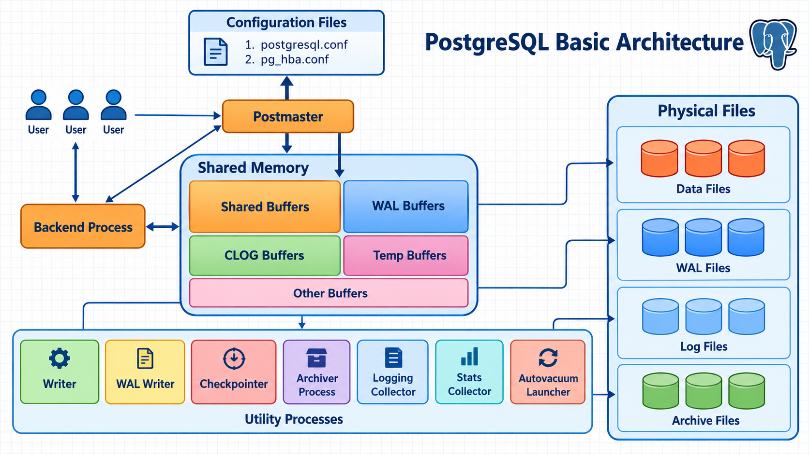
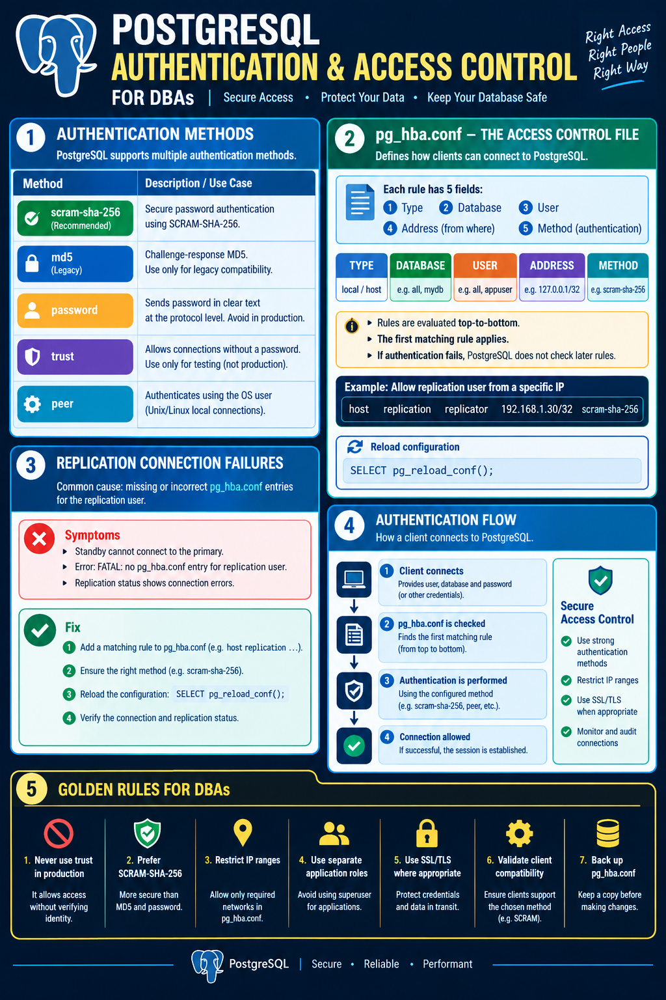
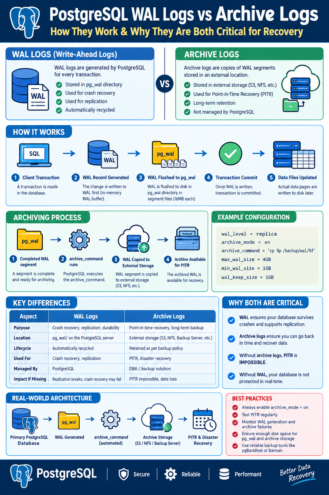

## PostgreSQL Basic Interview Questions:


### What is PostgreSQL?

PostgreSQL is an open-source, object-relational database management system (ORDBMS). It supports SQL, ACID transactions, MVCC, indexing, replication, JSON/JSONB, stored procedures and advanced query optimization.


### What are the main features of PostgreSQL?
- ACID compliance and transaction management
- MVCC (Multi-Version Concurrency Control)
- Streaming and logical replication
- Point-in-Time Recovery (PITR)
- Indexing: B-tree, Hash, GIN, GiST, BRIN
- JSON/JSONB support
- Table partitioning
- Extensions such as `pg_stat_statements` and PostGIS


### Explain the PostgreSQL Architecture:





#### Core Process: 

**Postmaster** – The main PostgreSQL process that starts the server, manages connections, and controls all background processes.

The **Postmaster** is the main PostgreSQL server process. It acts as the gateway for all client connections. The Postmaster Process acts as the central controller that initializes and monitors all PostgreSQL processes. It manages the entire database instance lifecycle. 

PostgreSQL handles concurrent connections through process isolation. Each client connection spawns a **dedicated server process**, allowing independent operation.


#### Backend Process:
Backend Process – A dedicated process created per client connection to execute SQL statements.


#### Shared Memory Components:
A **shared memory** segment serves as the communication hub, containing various buffers including the Shared Buffer Cache, WAL Buffer, Commit Log Buffer, and Work Memory areas.

1. Shared Buffers – Caches frequently accessed data pages to improve read/write performance.
2. WAL Buffers – Holds WAL (Write-Ahead Log) records in memory before writing them to disk.
3. CLOG Buffers – Stores transaction commit/rollback status for MVCC visibility.
4. Temp Buffers – Session-level memory used for temporary operations like sorting and hashing.
5. Other Buffers – Additional memory areas used for internal PostgreSQL operations.


#### Background / Utility Processes: 

1. Background Writer (bgwriter): Flushes dirty pages to disk periodically
   - Writes dirty buffers (modified data) from shared memory to disk.
   - Reduces the workload on backend processes during checkpoints.
2. WAL Writer: Ensures write-ahead log data is persisted
   - Writes Write-Ahead Logging (WAL) records to disk.
   - Ensures data consistency and aids in crash recovery.
3. Checkpointer: Forces all dirty buffers to disk at designated intervals
   -  Creates checkpoints by flushing all dirty buffers and marking recovery points.
   - Creates checkpoints by writing all dirty buffers to disk.
   - Ensures data consistency and aids in crash recovery.
4. Auto Vacuum: Initiates cleanup of dead tuples
   - Automatically starts vacuum processes to reclaim storage space and update table statistics.
   - Prevents table bloat and maintains performance.
5. Stats Collector: Gathers runtime statistics for the query optimizer.
6. System Logger/Logging Collector: Manages server logs
   - Captures PostgreSQL logs and writes them to log files.
   - Helps in debugging and monitoring database activity. 
7. Archiver Process: Copies WAL segments to archive storage
8. Replication Launcher: Coordinates logical replication workers


#### Physical Storage Files:
1. Data Files: Actual storage for tables, indexes, and database objects. Files that store the actual database data, organized into tables and indexes.
2. WAL Files: Records every database change for durability and replication. Maintain sequential log records for crash recovery
3. Archive Files : Hold backup and recovery data
4. Log Files:  Contains error logs, connection logs, and activity logs.. Record system events and error messages. 


#### Configuration Files
- postgresql.conf – Main configuration file for performance, memory, logging, and replication settings.
- pg_hba.conf – Authentication and client-access control configuration file.


### What are shared_buffers, WAL Buffers and work_mem?

#### `shared_buffers`: 
A shared memory area that caches frequently accessed data blocks. PostgreSQL's shared memory buffer cache for data pages.
   - Purpose: Reduces disk I/O by keeping hot data in memory.
   - Impact: Improves query performance significantly.

#### WAL Buffers:
Temporarily store Write-Ahead Logging (WAL) data before it’s written to disk. A small memory area that temporarily holds WAL records before they are written to disk.
   - Purpose: Ensures data durability by logging changes.

#### `work_mem`: 
Memory allocated for internal operations like sorting and hash tables. Memory available for individual query operations such as sorts and hash operations before they spill to disk.
   - Purpose: Each query can use this memory for processing.


`work_mem` can be consumed by multiple operations per query and many concurrent sessions. Setting it too high can exhaust server memory.


### PostgreSQL Shutdown Types:

PostgreSQL supports three shutdown modes using the `pg_ctl` utility. They differ in how PostgreSQL handles active client connections, running transactions, and shutdown speed.

| Shutdown Type | Command Option | Behavior | Use Case |
|---|---|---|---|
| Smart Shutdown | `pg_ctl stop` or `pg_ctl stop -m smart` | Waits for all connected clients to disconnect before shutting down. | Planned maintenance |
| Fast Shutdown | `pg_ctl stop -m fast` | Disconnects clients, aborts active transactions, and performs a clean shutdown. | Routine administration |
| Immediate Shutdown | `pg_ctl stop -m immediate` | Stops server processes immediately; crash recovery occurs on the next startup. | Emergency situations |


#### A. Smart shutdown:
- Rejects new client connections.
- Waits for existing clients to disconnect.
- Can take a long time if applications maintain persistent connections.
- Performs a clean shutdown.


#### B. Fast shutdown:
- Rejects new client connections.
- Terminates existing client sessions.
- Aborts active transactions.
- Performs a clean shutdown after rolling back uncommitted transactions and completing required shutdown operations.
- This is the default `pg_ctl stop` **mode** if no mode is specified.


#### C. Immediate shutdown:
- Stops PostgreSQL processes without normal shutdown procedures.
- Does not perform a normal checkpoint-based shutdown.
- Requires crash recovery when PostgreSQL starts again.
- Can cause temporary unavailability and longer startup times while recovery runs.


### What is the difference between a database, schema, and table?

- **Database**	: A container for database objects 
- **Schema**	: A namespace (logical container) inside a database. Used to organize database objects like tables, views, and functions into distinct namespaces.
- **Table**	: A table in PostgreSQL is a collection of rows and columns used to store structured data. Stores data in rows and columns.
- **Index** : Improves query performance.
- **View** : A virtual table based on the result of a query


### What are the different data types available in PostgreSQL?

- Numeric: Integer, Decimal, Float.
- Character: CHAR, VARCHAR, TEXT.
- Date/Time: DATE, TIME, TIMESTAMP, INTERVAL.
- Boolean: TRUE, FALSE.
- Geometric: Point, Line, Polygon.
- Network: CIDR, INET, MACADDR.
- JSON/JSONB.
- Array: Multi-dimensional arrays.


### What is the difference between CHAR, VARCHAR, and TEXT data types?

- `CHAR(n)`: Fixed-length character string. Spaces pad the string if the input is shorter than `n`.
- `VARCHAR(n)`: Variable-length string with a maximum length limit of `n`.
- `TEXT`: Variable-length string with virtually unlimited length (up to 1 GB). Performance-wise, all three perform similarly in PostgreSQL, so `TEXT` or `VARCHAR` are preferred over `CHAR`


### What are Primary Key, Foreign Key, and Unique constraints?

- **Primary Key**: A primary key uniquely identifies each row in a table. It cannot be null.
- **Foreign Key**: A foreign key links one table to another. It keeps data consistent.  Enforces a relationship with a referenced key.
- **Unique**: Prevents duplicate values or duplicate combinations, with NULL handling depending on the constraint and configuration.
- **NOT NULL**: Prevents NULL values.


### What is an index? What are the different types of indexes available in PostgreSQL?

An index helps PostgreSQL locate matching rows without scanning the entire table when the chosen execution plan benefits from it.

_PostgreSQL supports several specialized index types:_
- **B-Tree**: The default, all-purpose index type used for equality and range queries.
- **Hash**: Optimized strictly for simple equality (=) comparisons.
- **GIN** (Generalized Inverted Index): Ideal for data types with multiple internal elements, such as arrays, full-text search and JSONB documents.
- **GiST / SP-GiST**: Best for complex geometric, spatial, or network data.
- **BRIN (Block Range Index)**: Good for very large, naturally ordered tables. Perfect for massive, naturally ordered datasets (like timestamps) as it uses minimal disk space.


_For example:_
```
CREATE INDEX idx_employee_name ON employees(name);
```


### What is the difference between DELETE, TRUNCATE, and DROP?
- `DELETE`	: Deletes selected or all rows; supports `WHERE`. (Ex: DELETE FROM employees WHERE name = 'John Doe';)
- `TRUNCATE` :	Quickly removes all rows from a table 
- `DROP` :	Removes the table object itself 


### What is MVCC in PostgreSQL?

MVCC stands for **Multi-Version Concurrency Control**. MVCC is a mechanism PostgreSQL uses to handle concurrent transactions without locking the whole table, ensuring high concurrency while maintaining ACID properties. Each user connected to the database gets a "snapshot" of the database at the start of their transaction.

MVCC allows multiple transactions to access the database without blocking each other. It **uses snapshots to provide consistent reads** and avoids conflicts through row-versioning. **Each transaction sees a snapshot of the data**. This avoids read locks. Updates create new row versions instead of overwriting. Dead tuples are later cleaned up by VACUUM/autovacuum.


### What is the difference between VACUUM and VACUUM FULL?

PostgreSQL uses **MVCC (Multi-Version Concurrency Control)**, meaning when you update or delete a row, the old row is physically left on the disk as a hidden "dead tuple".


#### VACUUM: 
VACUUM scans tables to remove these dead tuples (dead rows) and reclaim the space; generally does **not require an ACCESS EXCLUSIVE table lock**.

- Removes dead tuple versions that are no longer needed.
- Makes their space available for reuse within the table.
- Usually does not shrink the table file or return that space to the operating system.
- Allows normal SELECT, INSERT, UPDATE, and DELETE operations to continue.
- Routine database maintenance.
- Runs quickly with minimal impact.


```
-- Vacuum a single table
VACUUM employees;

-- Vacuum and update query planner statistics
VACUUM ANALYZE employees;

-- Vacuum the entire database
VACUUM;

-- Verbose output
VACUUM VERBOSE employees;
```


#### VACUUM FULL: 

Rewrites the table and can return space to the operating system, but **requires an ACCESS EXCLUSIVE lock** and additional disk space. 

Performs a full cleanup, locks the table, and compacts it to free space. 

- Removes dead tuples and rewrites the entire table.
- Returns unused space back to the operating system.
- Reduces the table file size on disk.
- Requires an exclusive lock, so the table is unavailable while it runs.
- Requires an ACCESS EXCLUSIVE lock, blocking other operations on the table.
- Requires additional disk space while the rewrite is in progress.
- Before running VACUUM FULL on a large production table, check free disk space, lock impact, and maintenance windows.


```
-- Reclaim disk space by rewriting a table
VACUUM FULL employees;

-- Verbose output
VACUUM FULL VERBOSE employees;

-- Reclaim space and update statistics
VACUUM FULL ANALYZE employees;
```


# PostgreSQL VACUUM vs VACUUM FULL

| Feature | VACUUM | VACUUM FULL |
|---|---|---|
| Purpose | Reclaims dead tuple space for reuse | Rewrites the table to reclaim disk space |
| Disk Space Returned to OS | Usually no | Usually yes |
| Table Rewrite | No | Yes |
| Table Lock | Allows normal reads and writes | Requires ACCESS EXCLUSIVE lock |
| Application Availability | Usually remains available | Reads and writes are blocked on the table |
| Execution Speed | Usually faster | Usually slower |
| Additional Disk Space | Generally lower requirement | Requires extra disk space during rewriting |
| Index Handling | Cleans up dead index entries as needed | Rebuilds indexes as part of the rewrite |
| Best Use Case | Routine maintenance | Reclaiming substantial unused disk space |
| Recommended Frequency | Regularly, often through autovacuum | Only when justified |
| Command | `VACUUM table_name;` | `VACUUM FULL table_name;` |


#### VACUUM vs Autovacuum:
Both are used to **clean up dead tuples** (old versions of rows) and manage table bloat created by MVCC, but they differ in how and when they run.

- **VACUUM** is a manual command executed by a DBA or script to clean up dead tuples.
- Does not lock the table for reads/writes (non-blocking)


- **Autovacuum** (Automatic): autovacuum is a built-in background process that automatically triggers VACUUM and ANALYZE as needed.
- Enabled by default (`autovacuum = on` and `SHOW autovacuum;`) and runs continuously in the background
- Check autovacuum stats:
```
SELECT relname, n_dead_tup, last_autovacuum, last_vacuum
FROM pg_stat_user_tables;


SELECT
    schemaname, relname, n_live_tup, n_dead_tup, last_vacuum, last_autovacuum, last_analyze, last_autoanalyze FROM pg_stat_user_tables
ORDER BY n_dead_tup DESC;
```


_PostgreSQL VACUUM vs Autovacuum:_
| Feature | VACUUM | Autovacuum |
|---|---|---|
| Type | Manual maintenance command | Automatic background maintenance process |
| Execution | DBA runs it manually | PostgreSQL runs it automatically when triggered |
| Main Purpose | Clean up dead tuples and reclaim reusable space | Automatically vacuum tables and maintain database health |
| Trigger | DBA executes the command | Thresholds based on table activity and configuration |
| Table Lock | Uses a lightweight lock compatible with normal reads and writes | Uses a lightweight lock compatible with normal reads and writes |
| Application Availability | Normal reads and writes generally continue | Normal reads and writes generally continue |
| ANALYZE Statistics | `VACUUM` alone does not update planner statistics | Autovacuum can trigger automatic ANALYZE |
| Configuration | Command options control each execution | Controlled by postgresql.conf and per-table settings |
| Monitoring | Command output and database statistics | Logs, database statistics, and server monitoring |
| Best Use Case | Manual maintenance, troubleshooting, or scheduled operations | Routine ongoing maintenance |
| Recommended Practice | Run manually when needed | Keep enabled for normal production operations |


### What is the difference between pg_hba.conf and postgresql.conf?

```
select version();
SHOW data_directory;
SHOW config_file;
SHOW hba_file;
```


```
SHOW wal_level;
SHOW max_wal_senders;
SHOW max_replication_slots;
```

- `postgresql.conf`	: Server settings, memory, logging, port, WAL and replication settings
- `pg_hba.conf` :	Client authentication rules based on connection type, database, user and client address
- `pg_ident.conf` :	Maps external identities to PostgreSQL roles for supported authentication methods


### PostgreSQL authentication:

# PostgreSQL Authentication Methods

| Authentication Method | Description | Common Use Case |
| --------------------- |-------------|-----------------|
| `trust` | Allows connections without a password | Isolated testing only |
| `peer` | Authenticates using the operating-system username over local connections | Maps the OS user to a PostgreSQL role |
| `password` | Sends the password in clear text at the PostgreSQL protocol level | Avoid unless protected by TLS |
| `md5` | Uses challenge-response MD5 password authentication | Legacy compatibility |
| `scram-sha-256` | Uses SCRAM-SHA-256 password authentication | Recommended password authentication |





### What are the different types of PostgreSQL backup?

- **Logical backup**: Logical backup exports database objects and data as SQL statements. Uses `pg_dump` and `pg_dumpall`.
- **Physical backup**: Copies the database cluster using supported physical backup methods. Physical backups copy the database cluster's underlying files. They are suitable for recovering an entire PostgreSQL cluster or creating a standby server. Uses `pg_basebackup`, `pgBackRest` and `Barman`. 
- **WAL archiving**: Archives Write-Ahead Log files to support PITR.
- **Continuous Archiving**: Combines a physical base backup with the required WAL files for recovery to a target time or LSN.


### What is the difference between pg_dump and pg_basebackup?

| Feature | pg_dump	| pg_basebackup |
| ------- | -------	| ------------- |
| Type	| Logical	| Physical | 
| Scope	| Individual database or selected objects	| Entire PostgreSQL cluster |
| Portability |	Useful for migrations across compatible versions |	Intended for compatible physical cluster versions |
| PITR |	Not by itself	| Can be used with WAL archiving |
| Typical use |	Schema/data migration |	Standby creation and physical recovery |


### What is Point-in-Time Recovery (PITR)?

PITR restores a physical PostgreSQL backup and replays archived WAL records until a specified recovery target, such as a timestamp or transaction boundary.

Typical prerequisites:
- A valid physical base backup
- Required WAL files
- WAL archiving configured correctly
- Recovery target and recovery configuration


### What is WAL in PostgreSQL?

WAL stands for **Write-Ahead Logging**. PostgreSQL never writes data directly to disk first. It writes to WAL.

Before any changes are made to the database, the changes are first recorded in a log (WAL). PostgreSQL records changes in WAL before the corresponding data pages need to be written to disk. WAL supports crash recovery, replication and PITR.

WAL logs are stored in the `pg_wal` directory. This protects against crashes. After a crash, PostgreSQL replays WAL to restore changes. It also allows replication and point-in-time recovery.





_Here's what happens internally:_

- Every committed transaction is first written to the WAL.
- If the server crashes before dirty pages are written to disk, the WAL remains intact.
- On restart, the Startup Process reads the last checkpoint from pg_control.
- PostgreSQL replays the required WAL records and restores all committed changes.
- Uncommitted transactions are discarded automatically.
- Once recovery is complete, the database starts accepting client connections.


_How WAL Works:_
1. Change is written to WAL buffer
2. WAL is flushed to disk
3. Only then is data written to table files


```
1. INSERT / UPDATE SQL statement
             |
             v
2. Modified data page in shared_buffers
   + WAL records generated in WAL buffers
             |
             v
3. Transaction COMMIT
             |
             v
4. Required WAL records flushed to durable storage
   (depending on synchronous_commit and configuration)
             |
             v
5. COMMIT acknowledged to the client
             |
             v
6. Modified table pages written to data files later
   (by background writer, checkpointer, or other processes)
```


```
SHOW wal_level;
SHOW archive_mode;
SHOW archive_command;
SHOW synchronous_commit;
```


>  PostgreSQL doesn't recover from data files alone— it recovers by replaying WAL records from the last checkpoint, ensuring committed transactions are not lost.


### What is the difference between full, incremental, and differential backup?
- **Full**: Backs up the entire defined backup scope.
- **Incremental**: Backs up changes since a previous backup.
- **Differential**: Backs up changes since the last full backup.

PostgreSQL's built-in `pg_dump` is not a block-level incremental backup tool. Tools such as `pgBackRest` and `Barman` support more advanced physical backup and WAL management workflows.


### What is RPO and  RTO?

#### RPO: (Data loss)
RPO (Recovery Point Objective) is the maximum acceptable amount of data loss measured in time.

Example:
- RPO = 15 Minutes
- If the server fails at 10:30 AM, you should be able to recover data up to 10:15 AM.
- Maximum data loss = 15 minutes.


#### RTO: (Downtime)
RTO (Recovery Time Objective) is the maximum acceptable time to restore a service after a failure.

Example:
- RTO = 1 Hour
- If the server fails at 10:30 AM, the service should be restored by 11:30 AM.


### What is Streaming Replication?

Streaming replication continuously transfers WAL records from a **primary server to one or more standby servers**. A standby replays the received WAL to maintain a copy of the primary's data.


### What is the difference between streaming replication and logical replication?
| Feature	| Streaming replication	| Logical replication |
| ------	| -------------------	| ------------------- |
| Replication level	| Physical WAL changes	| Logical row changes |
| Typical scope	| Entire cluster	| Selected tables/publications | 
| Cross-major-version migration	| Generally not for direct physical replication	| Often useful, subject to version and feature compatibility |
| Standby read access	| Yes	| Subscriber is a normal writable PostgreSQL cluster | 
| DDL replication	| Physical changes follow WAL	| Schema/DDL changes generally need separate handling | 


### What is the difference between synchronous and asynchronous replication?

| Feature	| Synchronous	| Asynchronous |
| ------	| ----------	| ------------ |
| Commit acknowledgment	| Waits for configured standby acknowledgment	| Does not wait for standby acknowledgment |
| Write latency	| Usually higher	| Usually lower | 
| Data-loss risk during failover	| Can be reduced substantially, depending on configuration and acknowledged standby state	| Recent acknowledged transactions may be lost | 
| Availability considerations	| A synchronous standby outage can block commits under some configurations	| Primary can generally continue committing without a standby |


### What is a replication slot?

A replication slot tracks the WAL or logical changes that a consumer still needs. It prevents required WAL from being removed prematurely, but an inactive slot can cause WAL files to accumulate and fill the disk.

Check replication slots:
```
SELECT slot_name, slot_type, active,
       restart_lsn, confirmed_flush_lsn,
       wal_status
FROM pg_replication_slots;
```


### How do you check replication status on the primary?

```
SELECT application_name,
       client_addr,
       state,
       sync_state,
       sent_lsn,
       write_lsn,
       flush_lsn,
       replay_lsn
FROM pg_stat_replication;
```


### How do you check whether a server is primary or standby?
- false — the server is not currently in recovery, usually the primary.
- true — the server is in recovery, typically a standby.

```
SELECT pg_is_in_recovery();
```

### What is replication lag?

Replication lag is the delay between changes generated on the primary and their receipt, flushing or replay on a standby. It can result from network latency, disk I/O, heavy write workloads, slow replay or standby resource limitations.


### How do you check replication lag?

> Important: The replay timestamp query is only an approximate delay indicator. It can be misleading when the primary is idle. Also inspect WAL LSN positions, replay progress and replication slot status.

_On the primary:_
```
SELECT application_name,
       state,
       sync_state,
       write_lag,
       flush_lag,
       replay_lag
FROM pg_stat_replication;
```


_On the standby:_
```
SELECT now() - pg_last_xact_replay_timestamp()
       AS approximate_replay_delay;
```


### What is the use of pg_stat_activity?
The `pg_stat_activity` view provides information about the **active processes** in the PostgreSQL database. It is useful for **monitoring queries, client connections, and troubleshooting performance issues.**


### How do you check active database connections?

```
postgres=# \d pg_stat_activity;
```


```
SHOW max_connections;


SELECT state, count(*) FROM pg_stat_activity
GROUP BY state;
```


```
select * from pg_stat_activity;
```


```
SELECT datname, usename, application_name, client_addr, state, count(*)
FROM pg_stat_activity
GROUP BY datname, usename, application_name, client_addr, state
ORDER BY count(*) DESC;
```


```
SELECT pid, usename, application_name, state, query
FROM pg_stat_activity;
```


### How do you terminate a session?

```
SELECT pid from pg_stat_activity;

SELECT pg_terminate_backend(pid)
FROM pg_stat_activity
WHERE pid = 9933; 
```


### What is `EXPLAIN` and `EXPLAIN ANALYZE`?

EXPLAIN and EXPLAIN ANALYZE are two of the main tools use for PostgreSQL performance tuning.

- `EXPLAIN` shows the execution plan the optimizer intends to use. `EXPLAIN` shows the query planner's estimated execution plan. 
- `EXPLAIN ANALYZE` runs the query and shows what actually happened. `EXPLAIN ANALYZE` actually executes the query and reports actual execution statistics.


```
EXPLAIN ANALYZE
SELECT *
FROM Employees
WHERE Salary > 50000;
```

> Be careful with statements that modify data: `EXPLAIN ANALYZE` executes them. For a safe diagnostic example, use a SELECT query.


With `EXPLAIN`, you get things like:

- scan type, Seq Scan, Index Scan, Bitmap Heap Scan
- join strategy, Nested Loop, Hash Join, Merge Join
- estimated rows
- estimated cost
- sort, aggregate, and filter steps

It is safe when I just want to inspect the planner's choices without executing the statement.


With `EXPLAIN ANALYZE`, PostgreSQL actually executes the query and adds:

- actual execution time
- actual row counts
- loops
- whether estimates were accurate or badly off

That is usually where the real tuning starts, because bad estimates often point to the root cause, things like stale statistics, skewed data, missing indexes, or a query pattern the planner struggles with.


### How can you optimize query performance in PostgreSQL?

- Use `EXPLAIN` and `EXPLAIN ANALYZE` to understand query execution plans.
- Create appropriate indexes, including multi-column or partial indexes.
- Normalize or denormalize data based on access patterns.
- Use query caching where applicable.
- Optimize joins with proper indexing and limiting result sets.
- Regularly vacuum and analyze the database to update statistics.


### How do you troubleshoot a slow PostgreSQL query?

A strong interview answer:
1. Identify the slow query using logs or `pg_stat_statements`.
2. Run `EXPLAIN (ANALYZE, BUFFERS)`.
3. Check sequential scans, index scans, row-estimation errors and expensive joins or sorts.
4. Check table statistics and run ANALYZE when appropriate.
5. Review indexes and query structure.
6. Check locks, I/O, CPU, memory and concurrent workload.
7. Make one controlled change at a time and compare results.


### How do you handle deadlocks in PostgreSQL?
Deadlocks happen when two transactions block each other. PostgreSQL detects them automatically and kills one to break the cycle. To reduce risk, access tables in a consistent order, keep transactions short, and avoid holding locks longer than needed.


### How do you identify blocking queries and deadlocks?

```
SELECT pid, usename, state, wait_event_type,
       wait_event, query,
       pg_blocking_pids(pid) AS blocking_pids
FROM pg_stat_activity
WHERE cardinality(pg_blocking_pids(pid)) > 0;
```


### Can you describe the three levels of transaction isolation in PostgreSQL?
PostgreSQL exposes four SQL isolation levels, but in practice there are really three behaviors, because `READ UNCOMMITTED` works the same as `READ COMMITTED`.

Here’s the clean way to explain it:

- **READ COMMITTED**, default
- **REPEATABLE READ**
- **SERIALIZABLE**

And technically:
- **READ UNCOMMITTED** exists for standards compliance
- In PostgreSQL, it behaves exactly like **READ COMMITTED**


#### READ COMMITTED:
Each statement sees a fresh snapshot of committed data.
You never read uncommitted changes from other transactions.
Two queries inside the same transaction can see different results if someone else commits in between.
Good default for most application workloads.


#### REPEATABLE READ:
The whole transaction works from one consistent snapshot taken at the start of the transaction.
Re-running the same query in that transaction gives the same result.
Prevents non-repeatable reads.
Still allows some concurrency patterns that may need care in complex business logic.


#### SERIALIZABLE:
Strongest isolation level.
PostgreSQL makes concurrent transactions behave as if they ran one at a time.
Best when correctness matters more than throughput.
Can raise serialization failures, so the app should be ready to retry the transaction.


A practical interview-friendly way to say it:
- **READ COMMITTED** = snapshot per statement
- **REPEATABLE READ** = snapshot per transaction
- **SERIALIZABLE** = safest, but may require retries


One PostgreSQL-specific detail worth calling out:
- PostgreSQL does not allow dirty reads
- So **READ UNCOMMITTED** does not actually give weaker behavior than **READ COMMITTED**


### What is a trigger in PostgreSQL? Can you give an example of its usage?

In PostgreSQL, a trigger is a specified set of actions that are executed automatically when certain events (INSERT, UPDATE, DELETE, or TRUNCATE) occur in the database. Triggers can be useful for maintaining complex integrity constraints beyond those that can be handled by simple foreign key and check constraints, for auditing data modifications, or for implementing complex business rules.


### What are extensions in PostgreSQL?

Extensions are packages that add additional functionality to PostgreSQL. Common extensions include:

- pgcrypto: For cryptographic functions.
- hstore: For key-value storage.
- PostGIS: For spatial and geographic data.


### What is the difference between JSON and JSONB in PostgreSQL?

- **JSON**: Stores data in plain text format, retaining the input structure.
- **JSONB**: Stores data in a binary format for faster searching and efficient indexing.
- Use JSONB when you need to query, index, or manipulate JSON data frequently.


### How do you migrate a large database from MySQL to PostgreSQL?

I export the MySQL schema and data using tools like `mysqldump` or mydumper. Then I convert the schema using `pgloader` or `ora2pg` (it supports MySQL too). I test migration on staging first. Large datasets are better loaded in chunks or during low-traffic hours to avoid downtime.


### What are the main constraints in PostgreSQL?

PostgreSQL providers for the following constraints:
- Check Constraints
- Not-Null Constraints
- Unique Constraints
- Primary Keys
- Foreign Keys
- Exclusion Constraints


### What is partitioning in PostgreSQL?

It’s the process of splitting a large table into smaller pieces. It can be done through several methods, including **range partitioning**, **list partitioning**, and **hash partitioning**.


### What commands are used to control transactions in PostgreSQL?

_There are 3 main commands to control transactions in PostgreSQL:_

- **BEGIN TRANSACTION** or simply **BEGIN**: To start a transaction.
- **COMMIT** or **END TRANSACTION**: To save the changes. The COMMIT command saves all transactions to the database since the last COMMIT or ROLLBACK command.
- **ROLLBACK**: It’s used to undo transactions that have not already been saved to the database.


### What is a trigger in PostgreSQL?

A trigger is a function that is automatically invoked before or after an event (like `INSERT`, `UPDATE`, `DELETE`) occurs on a table.


### Differences between DATE and TIMESTAMP ?
#### DATE:
- Stores only the date part (year, month, and day).
- Format: YYYY-MM-DD.

#### TIMESTAMP:
- Stores both date and time parts (year, month, day, hour, minute, second).
- Format: YYYY-MM-DD HH:MM:SS.


